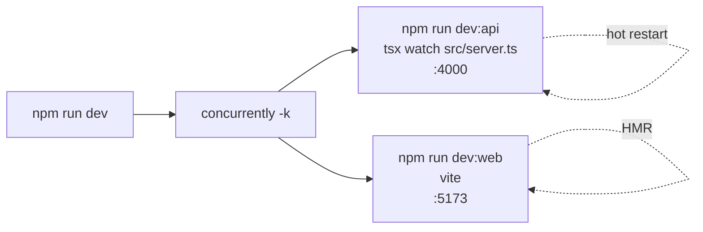

# 01 — Monorepo & tooling

> npm workspaces + concurrently + one root `.env`: one repo, two apps, one command to run everything.

**Back to:** [Implementation Walkthrough — Step 0](../history/implementation-walkthrough.md#1-step-0--repository-foundation) · [Concept index](../history/implementation-walkthrough.md#concept-index)

> **Current implementation note:** the root scripts now include `setup`, `docker:*`, `db:setup`, and `seed`; backend dependencies also include `mysql2`, `mongodb`, and `node-sql-parser`. See [CURRENT_STATE](../architecture/current-state.md) for the actual stack.

## What it is

A **monorepo** holds multiple deployable units (here: `apps/frontend` and `apps/backend`) in one git repository with a shared install and shared scripts. npm's native mechanism is **workspaces**: the root `package.json` lists the package directories; `npm install` hoists shared dependencies into the root `node_modules/` and symlinks workspace packages so they can import each other.

**Prerequisites:** Node 20+ and npm. Read [02 — TypeScript configuration](02-typescript-config.md) next, since each workspace has its own tsconfig.

## Why this project uses it

- One clone, one `npm install`, one `npm run dev` — the README's acceptance criterion depends on this.
- Backend and frontend share TypeScript, tsx, and Vite versions from the root lockfile — no version drift.
- Root scripts compose workspace scripts: `npm test` and `npm run typecheck` fan out with `-w`.
- The E2E runner (Playwright, in the frontend workspace) can boot both apps because it lives in the same tree.
- The target database is external, but the **demo** target database lives in the same repo (`docker-compose.yml` + `apps/backend/demo/target-schema.sql`), so a clean clone can demo the whole loop.

Alternatives considered: two independent repos (drift, double installs, painful E2E), Nx/Turborepo (real caching and task graphs, but heavy for a focused MVP). npm workspaces is the middle that costs almost nothing.

## When to use this pattern

- 2–6 packages that deploy separately but evolve together.
- A frontend + API + shared-types trio (this project).
- Any project where "clone and run one command" is a goal.

Reach for Nx/Turborepo when build times hurt or you have many packages with complex dependency graphs.

## How it works here

### Root `package.json`

```json
{
  "name": "database-knowledge-assistant",
  "private": true,
  "workspaces": ["apps/frontend", "apps/backend"],
  "scripts": {
    "dev": "concurrently -k -n api,web \"npm:dev:api\" \"npm:dev:web\"",
    "dev:api": "npm run dev -w apps/backend",
    "dev:web": "npm run dev -w apps/frontend",
    "test": "npm run test -w apps/backend",
    "test:e2e": "npm run test:e2e -w apps/frontend",
    "typecheck": "npm run typecheck -w apps/backend && npm run typecheck -w apps/frontend",
    "build": "npm run build -w apps/backend && npm run build -w apps/frontend"
  },
  "devDependencies": { "concurrently": "^9.1.2" }
}
```

Key points:

- `"private": true` — required; npm refuses to publish workspace roots, and prevents accidental `npm publish`.
- `-w <workspace>` (alias `--workspace`) runs a script inside a workspace as if you had cd'd there: `npm run dev -w apps/backend` executes `apps/backend`'s `dev` script.
- `concurrently -k` runs both dev servers in one terminal, prefixing log lines (`[api]`, `[web]`), and `-k` kills the sibling when one exits — no orphan Vite when the API crashes.
- The root does **not** depend on `pg`, React, or Express. Dependencies live with the app that uses them.

### Workspace packages

Each app has its own `package.json` with only *its* dependencies:

```jsonc
// apps/frontend/package.json (excerpt)
{ "name": "frontend", "private": true, "type": "module",
  "scripts": { "dev": "vite", "build": "tsc -b && vite build", "typecheck": "tsc --noEmit" } }

// apps/backend/package.json (excerpt)
{ "name": "backend", "private": true,
  "scripts": { "dev": "tsx watch src/server.ts", "test": "NODE_OPTIONS=--experimental-vm-modules jest --runInBand" } }
```

`npm install` at the root produces a **hoisted** `node_modules/`: one copy of `typescript`, `pg`, `react`, etc., resolvable from anywhere in the tree. The apps do **not** import each other via package names; they communicate only over HTTP. Keep it that way until you truly need a `packages/shared` — premature sharing couples your build graphs.

### The dev loop



`tsx watch` restarts the Express process on backend changes; Vite HMR updates the browser without a reload. The port split (4000/5173) means no proxy surprises beyond the one Vite `server.proxy` rule that forwards `/api` to the backend.

### Docker lives outside npm

`docker compose up -d` starts two services: `app-postgres` and `demo-postgres`. npm does not manage containers; the README documents both commands. Keeping infrastructure out of npm scripts avoids hiding long-running services behind a script that looks like it should exit.

## Pitfalls we hit (and fixes)

1. **Scripts run with CWD = the workspace directory.** `npm run dev -w apps/backend` has `process.cwd() === apps/backend`, so a naive `dotenv.config()` loads `apps/backend/.env`, not the repo root. Fix: load the root `.env` explicitly in `db.ts` with `path.resolve(__dirname, '../../../.env')`, then allow a closer `.env` to override. See [03 — Docker, Postgres & environment](03-docker-postgres.md).
2. **Lockfile drift.** Commit `package-lock.json` immediately. A clean clone with a different lockfile is a different project.
3. **`type: module` inheritance surprise.** `"type": "module"` in the frontend package makes every `.ts`/`.js` under it ESM — including Playwright specs, where `__dirname` does not exist (use `fileURLToPath(import.meta.url)`).
4. **Running tests from the wrong workspace.** `npm test` at the root fans out via the root script. Running Jest inside the frontend does nothing useful; keep the fan-out at the root.
5. **Importing backend code from the frontend.** It type-checks by accident and then breaks at runtime. Treat the HTTP API as the only boundary.

## Verification checklist

```bash
npm install                      # one install, one lockfile
npm run typecheck                # runs both workspaces
npm run dev                      # both servers, prefixed logs, Ctrl-C kills both
docker compose up -d             # app DB + demo target DB
```

## Backlinks

- Walkthrough: [Step 0 — Repository foundation](../history/implementation-walkthrough.md#1-step-0--repository-foundation)
- Related: [02 — TypeScript configuration](02-typescript-config.md) · [03 — Docker, Postgres & environment](03-docker-postgres.md) · [12 — Testing strategy](12-testing-strategy.md)
