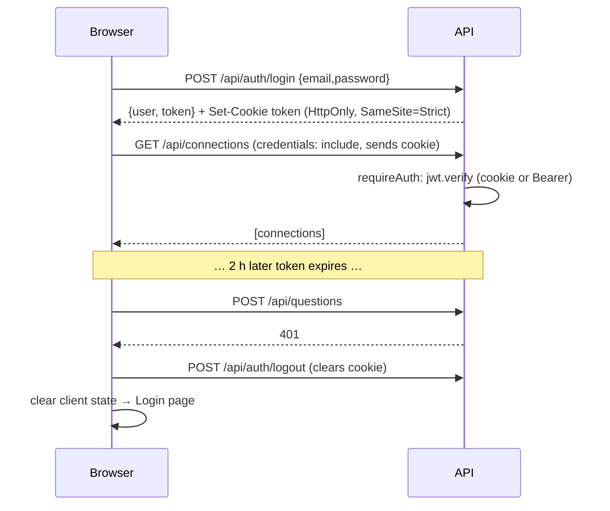

# 05 — Auth with bcrypt + JWT

> Signup/login, a `requireAuth` middleware, and a frontend token lifecycle — the small backend surface that gates every connection, session, and query. JWTs are delivered via `HttpOnly` `SameSite=Strict` cookies (the `Authorization: Bearer` header is also accepted for backward compatibility).

**Back to:** [Implementation Walkthrough](../history/implementation-walkthrough.md#concept-index) · [04 — Express API structure](04-express-api-structure.md)

> **Current implementation note:** the `admin` role is now actively used. Admin users can manage provider/model configurations under **AI providers** and recovery records under **Recovery**; non-admins receive `403` from those routes.

## What it is

- **bcrypt** hashes passwords with a per-user salt and a tunable cost factor. The database stores only the hash; verification is `bcrypt.compare(candidate, storedHash)`.
- **JWT (JSON Web Token)** is a signed, stateless credential. The server signs `{ sub: userId, role }` with `JWT_SECRET`; any request presenting a valid signature is trusted without a session lookup.
- **`requireAuth`** is Express middleware that validates the token from the `Authorization: Bearer <token>` header **or** the `token` HttpOnly cookie and attaches `req.user`.
- **Cookies:** `POST /api/auth/signup` and `POST /api/auth/login` set `Set-Cookie: token=...; HttpOnly; SameSite=Strict; Path=/; Max-Age=7200` (+`Secure` in production). `POST /api/auth/logout` clears the cookie. The frontend sends `credentials: 'include'` on all API fetches.

**Prerequisites:** [04 — Express API structure](04-express-api-structure.md) (routers, error flow). [03 — Docker, Postgres & environment](03-docker-postgres.md) (`JWT_SECRET` handling).

## Why this project uses it

- Every connection, session, and evidence row belongs to a user. Without auth there is no ownership to enforce.
- The most dangerous object in the app is a database credential. Auth is the first gate before a user can even create one.
- JWTs are stateless: no session table, no Redis — right-sized for a small internal tool.
- bcrypt is the baseline expectation for password storage; its cost factor makes offline cracking expensive.

**The honest trade-off:** the API issues tokens as `HttpOnly` `SameSite=Strict` cookies and accepts a Bearer header. However, the web client still mirrors the JWT in `localStorage` and sends it as a Bearer header, so XSS can still exfiltrate the token; stateless revocation is also still a gap. The cookie path adds CSRF surface, mitigated by `SameSite=Strict` and `credentials: 'include'`. Finishing the migration means removing client-side token persistence and adding CSRF protection plus refresh/revocation. For an internal MVP this is a documented, conscious choice. See [13 — Security checklist](13-security-checklist.md).

## When to use this pattern

- MVPs and internal tools where scale is low and you want zero session infrastructure.
- Service-to-service calls (API keys are simpler still).
- **Not** for high-security production without the cookie migration; and if you need server-side revocation ("log out everywhere"), add a token-denylist or sessions table.

## How it works here

### Schema

```sql
CREATE TABLE users (
  id uuid PRIMARY KEY DEFAULT gen_random_uuid(),   -- requires pgcrypto
  email text NOT NULL UNIQUE,
  password_hash text NOT NULL,
  role text NOT NULL DEFAULT 'user' CHECK (role IN ('user', 'admin')),
  created_at timestamptz NOT NULL DEFAULT now()
);
```

`UNIQUE` on email gives duplicate detection for free — the insert raises Postgres error `23505`, which the route maps to HTTP 409.

### Signup — `POST /api/auth/signup`

```ts
authRouter.post('/signup', async (req, res, next) => {
  try {
    const email = String(req.body.email || '').trim().toLowerCase();
    const password = String(req.body.password || '');

    if (!/^\S+@\S+\.\S+$/.test(email) || password.length < 8) {
      return res.status(400).json({
        error: 'Valid email and password of at least 8 characters required.'
      });
    }

    const passwordHash = await bcrypt.hash(password, 10);
    const { rows } = await pool.query(
      'INSERT INTO users(email, password_hash) VALUES ($1, $2) RETURNING id, email, role',
      [email, passwordHash]
    );

    return res.status(201).json({ user: rows[0], token: signToken(rows[0]) });
  } catch (error: any) {
    if (error.code === '23505') {
      return res.status(409).json({ error: 'Email already registered.' });
    }
    next(error);
  }
});
```

Details worth copying: normalize email before uniqueness matters (lowercase + trim); cost factor 10 is fast enough for tests and expensive for attackers; `RETURNING id, email, role` lets the token be signed in the same round-trip; never reveal which field caused a validation failure.

### Login — `POST /api/auth/login`

```ts
const { rows } = await pool.query(
  'SELECT id, email, role, password_hash FROM users WHERE email = $1',
  [email]
);
const user = rows[0];

if (!user || !(await bcrypt.compare(password, user.password_hash))) {
  return res.status(401).json({ error: 'Invalid email or password.' });
}

const { password_hash: _passwordHash, ...safeUser } = user;
return res.json({ user: safeUser, token: signToken(safeUser) });
```

Two security details: the same 401 message for unknown email and wrong password (no user enumeration), and the hash is stripped before the response. Returning the raw row is a classic leak.

### Token creation

```ts
function signToken(user: { id: string; role: string }) {
  const secret = process.env.JWT_SECRET;
  if (!secret) throw new Error('JWT secret missing');   // fail loud, never default
  return jwt.sign({ sub: user.id, role: user.role }, secret, { expiresIn: '2h' });
}
```

`sub` (subject) is the JWT standard claim for "who". A 2 h expiry limits the blast radius of a stolen token.

On signup/login, `respondWithToken` sets `Set-Cookie: token=<token>; HttpOnly; SameSite=Strict; Path=/; Max-Age=7200` (plus `Secure` when `NODE_ENV=production`) and returns the token in the JSON body as well, so Bearer-header clients keep working.

### `requireAuth` middleware — `src/middleware/auth.ts`

```ts
export function requireAuth(req: Request, res: Response, next: NextFunction) {
  const authHeader = req.headers.authorization || '';
  const token =
    authHeader.startsWith('Bearer ') ? authHeader.slice(7) : readTokenCookie(req) || '';

  if (!token) return res.status(401).json({ error: 'Authentication required.' });

  try {
    const secret = process.env.JWT_SECRET;
    if (!secret) throw new Error('JWT secret missing');

    const payload = jwt.verify(token, secret) as jwt.JwtPayload;
    if (typeof payload.sub !== 'string') {
      return res.status(401).json({ error: 'Invalid token.' });
    }

    req.user = { id: payload.sub, role: (payload.role as 'user' | 'admin') || 'user' };
    next();
  } catch {
    return res.status(401).json({ error: 'Invalid or expired token.' });
  }
}

function readTokenCookie(req: Request): string | null {
  const cookieHeader = req.headers.cookie || '';
  const match = cookieHeader.match(/(?:^|;\s*)token=([^;]*)/);
  return match ? match[1] : null;
}
```

`jwt.verify` checks signature and expiry in one call; any failure → 401. The global Express augmentation makes `req.user.id` typed everywhere:

```ts
declare global {
  namespace Express {
    interface Request {
      user?: { id: string; role: 'user' | 'admin' };
    }
  }
}
```

Under `strict: true`, every `req.user?.id` use is a reminder that auth ran. Routes with `requireAuth` in the chain can use `req.user!.id` deliberately; routes without it cannot compile accidentally.

### Ownership is not the same as authentication

Auth tells you **who** is calling. Ownership checks tell you **what they may touch**:

```sql
SELECT id, name, host, port, database_name, username, ssl_mode,
       (password_encrypted IS NOT NULL) AS has_password
FROM database_connections
WHERE id = $1 AND owner_id = $2
```

Put `owner_id` in the SQL for every connection, session, and turn query. A logged-in user must not be able to read another user's connection details or evidence.

### Frontend token lifecycle

```text
signup/login success ──► Set-Cookie: token (HttpOnly, SameSite=Strict) ──► every fetch sends cookie (credentials: include)
401 response           ──► clearCookie ──► reload ──► login page
```

- `api/client.ts` owns the fetch wrapper: `credentials: 'include'` on every request, `Authorization: Bearer` header also set when `getToken()` returns a value (backward-compat).
- The 401 handler lives in the single `request()` wrapper, so one expired token anywhere logs the user out everywhere.
- Expiry is not proactively refreshed; a mid-session expiry just produces a 401 → logout.
- `signOut()` calls `POST /api/auth/logout` (clears the cookie) then clears local client state.



## Pitfalls we hit (and fixes)

1. **Returning the raw user row on login.** The first version returned `rows[0]`, including `password_hash`. Read the full response JSON in integration tests, not just the status code. Fix with the destructure-and-spread shown above.
2. **`JWT_SECRET` missing in production.** `signToken` and `requireAuth` both throw early if the secret is absent — better a loud boot failure than signing tokens with `undefined`.
3. **User enumeration via timing.** Skipping `bcrypt.compare` for a missing user makes unknown-email logins measurably faster. Acceptable at MVP scale; at hardening time, run a dummy compare against a fixed hash.
4. **Token in query strings.** Never accept `?token=` — it lands in logs, browser history, and proxies. Headers only.
5. **Forgetting ownership filters on nested resources.** Auth is necessary but not sufficient. `GET /api/conversations/:id` must filter by `user_id`; `POST /api/questions` must load the conversation by owner before reading its connection.
6. **Cookie + Bearer ambiguity.** `requireAuth` accepts both; ensure the frontend doesn't double-send (cookie via `credentials: include` plus `Authorization` header) unless intentionally supporting both client types.

## Verification checklist

```bash
# signup -> 201 + token + Set-Cookie
curl -s -i -X POST localhost:4000/api/auth/signup \
  -H 'Content-Type: application/json' \
  -d '{"email":"a@b.com","password":"password123"}'

# duplicate -> 409; short password -> 400
# login wrong password -> 401 "Invalid email or password."
# protected route without token -> 401; with cookie -> 200
# another user's connection id -> 404
# POST /api/auth/logout -> clears Set-Cookie
```

## Backlinks

- Walkthrough: [Step 1 — Auth and app schema](../history/implementation-walkthrough.md#2-step-1--authentication-and-application-schema)
- Related: [04 — Express API structure](04-express-api-structure.md) · [06 — Database connections & encryption](06-database-connections-encryption.md) · [11 — Frontend architecture](11-frontend-architecture.md) · [13 — Security checklist](13-security-checklist.md)
