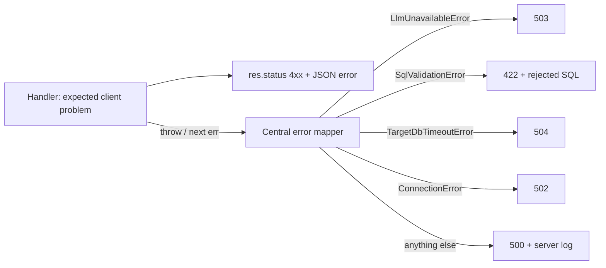

# 04 — Express API structure

> `app.ts` vs `server.ts`, routers per resource, one central error mapper — the shape that keeps connection, session, and query code readable.

**Back to:** [Implementation Walkthrough](../Implementation_Walkthrough.md#concept-index) · [05 — Auth with bcrypt + JWT](05-auth-jwt.md)

> **Current implementation note:** routers now include admin model/provider CRUD. `app.ts` maps `LlmUnavailableError` and invalid JSON globally; route handlers map scope, validation, target-timeout, and database errors locally. See [API reference](../../apis/README.md).

## What it is

Express apps scale cleanly when you separate three concerns:

1. **`app.ts`** — builds the Express application: middleware stack, route mounting, the global error handler. Importable without binding a port, which is what makes Supertest integration tests possible.
2. **`server.ts`** — the process entrypoint: reads `PORT`, calls `app.listen`, logs, handles fatal startup errors. The only file that touches the network socket.
3. **Routers** — one file per resource (`auth.routes.ts`, `connections.routes.ts`, `conversations.routes.ts`, `questions.routes.ts`). A router holds URL logic only; reusable logic goes in `middleware/` (auth) or `services/` (LLM, encryption, introspection, SQL guard, agent).

**Prerequisites:** [02 — TypeScript configuration](02-typescript-config.md). [05 — Auth](05-auth-jwt.md) for `requireAuth`.

## Why this project uses it

- **Testability:** `test/api.test.ts` imports `{ app }` and lets Supertest bind an ephemeral port. If `app.ts` also called `listen`, tests would fight over port 4000.
- **One error boundary:** every async route handler catches and calls `next(error)`; a single Express error middleware maps known error types to status codes. HTTP concerns are not duplicated in handlers.
- **A clear ownership boundary:** connection and session queries live in their routers/services, and the questions route composes them. A new developer can open `app.ts` and see the whole API surface.
- **Safe error mapping:** target database errors must not leak credentials or connection strings. A central mapper is the one place to enforce that.

## When to use this pattern

- Any Express/Connect service with more than ~3 routes.
- Any service you intend to integration-test without sockets.
- Split further (`controllers/`, `services/`) past ~10 resources — not needed here.

## How it works here

### `apps/backend/src/app.ts` (the whole file, condensed)

```ts
import 'dotenv/config';
import express from 'express';
import cors from 'cors';
import helmet from 'helmet';
import morgan from 'morgan';
import { authRouter } from './routes/auth.routes';
import { connectionsRouter } from './routes/connections.routes';
import { conversationsRouter } from './routes/conversations.routes';
import { questionsRouter } from './routes/questions.routes';
import { modelsRouter } from './routes/models.routes';
import { LlmUnavailableError } from './services/llm';
import { ConnectionError } from './services/connectionPool';
import { SqlValidationError } from './services/sqlGuard';
import { TargetDbTimeoutError } from './services/sqlExecution';

export const app = express();

app.use(helmet());
app.use(cors({ origin: process.env.FRONTEND_ORIGIN || 'http://localhost:5173' }));
app.use(express.json({ limit: '1mb' }));
app.use(morgan('tiny'));

app.get('/api/health', (_req, res) => {
  res.json({ ok: true, message: 'API is running' });
});

app.use('/api/auth', authRouter);
app.use('/api/connections', connectionsRouter);
app.use('/api/conversations', conversationsRouter);
app.use('/api/questions', questionsRouter);
app.use('/api/models', modelsRouter);

// The 4-argument signature is how Express recognizes error middleware.
app.use((err: any, _req: express.Request, res: express.Response, _next: express.NextFunction) => {
  if (err instanceof LlmUnavailableError) {
    return res.status(503).json({
      error: 'The language model is unavailable right now. Please try again in a moment.'
    });
  }
  if (err instanceof SqlValidationError) {
    return res.status(422).json({ error: err.message, sql: err.sql });
  }
  if (err instanceof TargetDbTimeoutError) {
    return res.status(504).json({ error: 'The database query took too long. Try a narrower question.' });
  }
  if (err instanceof ConnectionError) {
    return res.status(502).json({ error: 'Could not reach the database. Check the connection details.' });
  }

  console.error(err);
  res.status(500).json({ error: 'Unexpected server error.' });
});
```

Middleware order matters: `helmet` → `cors` → `json` → `morgan` → routes → error handler. The error handler must be registered after the routes and must keep its 4-argument signature; Express identifies error middleware solely by `fn.length === 4`. Dropping `_next` silently disables the chain.

Do not return `err.message` for unexpected 500s. Internal database errors can include hostnames, relation names, or query fragments. The handler logs the real error server-side and returns a generic message to the client.

### `apps/backend/src/server.ts`

```ts
import { app } from './app';

const port = Number(process.env.PORT || 4000);
app.listen(port, () => {
  console.log(`API listening on http://localhost:${port}`);
});
```

That is the entire file. `PORT` is read here after `app.ts` has loaded env.

### A route file's anatomy (`connections.routes.ts`, condensed)

```ts
export const connectionsRouter = Router();

connectionsRouter.get('/', requireAuth, async (req, res, next) => {
  try {
    const { rows } = await pool.query(
      `SELECT id, name, host, port, database_name, username, ssl_mode,
              (password_encrypted IS NOT NULL) AS has_password,
              created_at, updated_at
       FROM database_connections
       WHERE owner_id = $1
       ORDER BY created_at DESC`,
      [req.user!.id]
    );
    res.json(rows);
  } catch (error) {
    next(error);
  }
});
```

Rules the codebase follows consistently:

- `next(error)` for anything unexpected; `res.status(4xx).json({ error })` for expected client errors (validation, not-found, conflict).
- Every **app-database** query is parameterized (`$1`). The only dynamic SQL in the project is generated by the model for the **target** database, and it goes through the SQL guard, not direct concatenation.
- Ownership filters live in the SQL (`WHERE owner_id = $1`), not in post-query JS. A missing filter cannot leak another user's row.
- Never select `password_encrypted` into a response object. If the column is needed for a test or service, select it explicitly and keep it out of the HTTP layer.

### Error-flow diagram



### The questions route is different

Most routes are ordinary JSON handlers. `POST /api/questions` can respond as SSE:

```ts
const wantsStream = (req.headers.accept || '').includes('text/event-stream');
if (wantsStream) {
  return streamFromAgent(res, ctx);
}
return res.json(await runAgent(ctx));
```

Keep the SSE writer in a small helper (`sseSend`, `endStream`) and always call `endStream` in a `finally`-style path. A route that returns after `res.flushHeaders()` without ending the response leaves the browser spinning.

### Error classes worth defining

```ts
export class ConnectionError extends Error {}
export class SqlValidationError extends Error {
  constructor(message: string, readonly sql: string) {
    super(message);
  }
}
export class TargetDbTimeoutError extends Error {}
export class TableScopeError extends Error {}
```

A small set of named errors is easier to map and test than string matching on `err.message`.

## Pitfalls we hit (and fixes)

1. **Error middleware with 3 args.** Removing `_next` makes Express stop treating it as error middleware; errors fall through as unhandled and requests hang. Keep all four parameters even when unused.
2. **Leaking target DB details in 500s.** A raw `pg` error can include the database name, SQL fragment, or role. Log it, return a generic message. For user-caused SQL errors, return a curated `SqlValidationError` or a sanitized execution message.
3. **Reading env at module load.** A service that captures `process.env.SQL_MAX_ROWS` at import time ignores test overrides. Read per call or through a small config function.
4. **CORS mismatch.** `cors({ origin: FRONTEND_ORIGIN })` must match Vite's actual port. A mismatch shows up as an opaque "Failed to fetch" in the browser, not a server error. Check the network tab's preflight first.
5. **Mounting the connections router under `/api` twice.** `app.use('/api', connectionsRouter)` plus routes already prefixed with `/connections` produces `/api/connections` only if you are consistent. Choose one convention and keep it.
6. **SSE and compression.** If you add compression middleware later, disable it for `text/event-stream`; buffering defeats streaming.

## Verification checklist

```bash
curl -s http://localhost:4000/api/health
curl -s http://localhost:4000/api/connections          # 401 JSON — proves middleware chain
npm test                                                # integration tests import the app object
```

## Backlinks

- Walkthrough: [Step 3 — Connections](../Implementation_Walkthrough.md#4-step-3--database-connections-and-encryption) · [Step 6 — SQL agent](../Implementation_Walkthrough.md#7-step-6--read-only-sql-and-the-nl-to-sql-agent)
- Related: [05 — Auth with bcrypt + JWT](05-auth-jwt.md) · [06 — Database connections & encryption](06-database-connections-encryption.md) · [13 — Security checklist](13-security-checklist.md)
